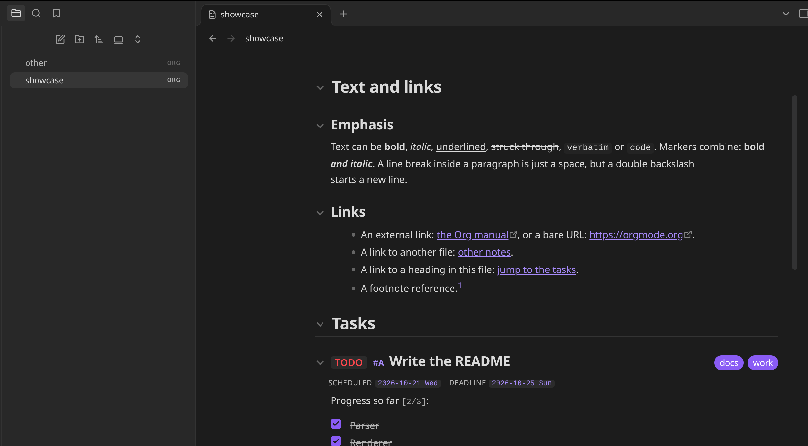
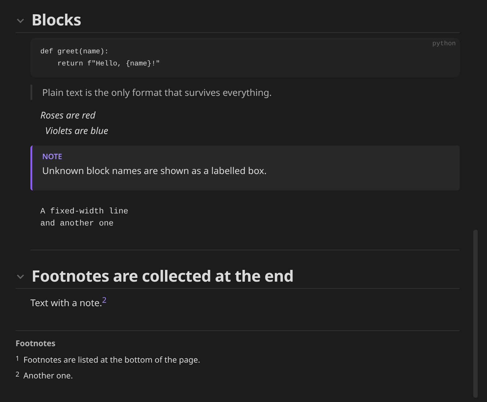
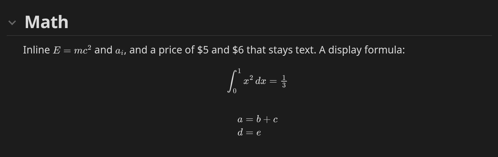
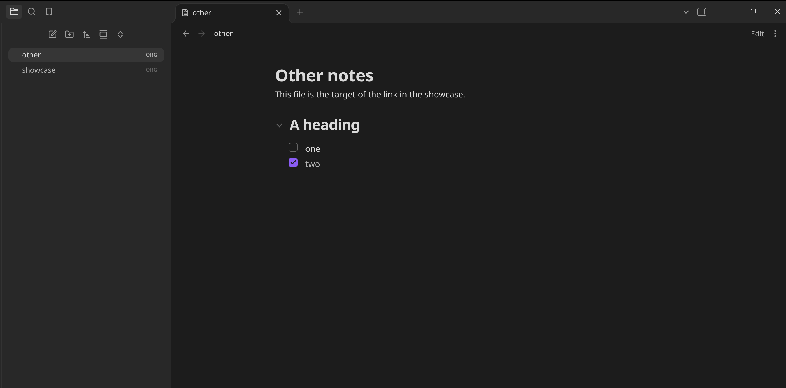
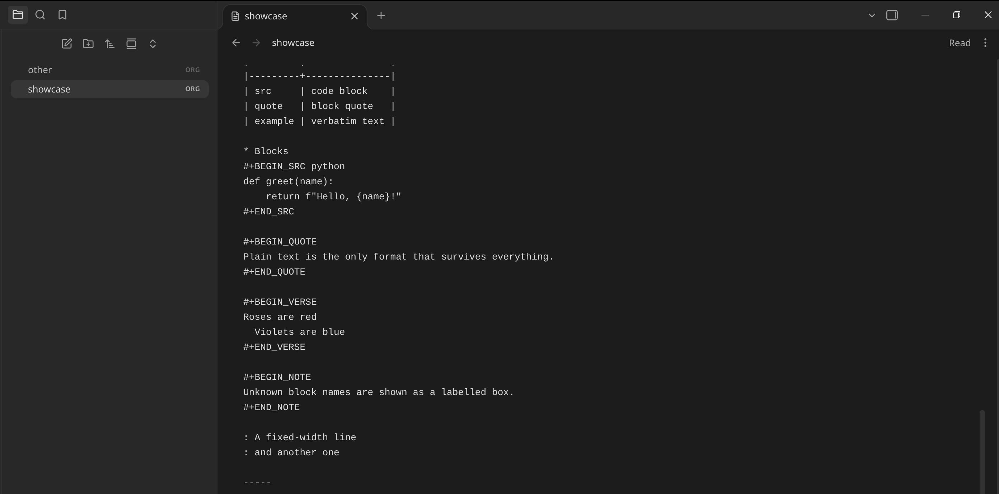

# Org Reader

[](https://github.com/ESeNonFossiIo/obsidian-org-reader/actions/workflows/ci.yml)

Obsidian plugin that opens `.org` files in a clean, easy-to-read view, and edits them in
a CodeMirror editor with Org highlighting, folding and Org-style keys. It has its own Org
parser and renderer, so it does not depend on any other Org plugin and replaces
Orgmode (cm6). A button in the view header switches between reading and editing.

> Only one plugin can handle the `.org` extension. If you use
> [Orgmode (cm6)](https://github.com/bbazard/obsidian-orgmode-cm6), disable it first
> (Settings → Community plugins) and restart Obsidian. Org Reader shows a notice on
> startup when the extension is already taken.

## Screenshots

Reading view: headings, inline formatting, links, TODO keywords, tags and dates.



Code, quote, verse and note blocks, with footnotes collected at the end.



LaTeX math, inline and display, typeset with Obsidian's MathJax.



Task lists, in a small file.



The editor: the same file as text, one click away with the Edit button.



## Editing

In editing mode the file is a CodeMirror editor with Org syntax highlighting (headings,
TODO keywords, tags, links, timestamps, markup, blocks, tables, math). Keys, which are
also commands you can bind in Settings → Hotkeys:

| Key | On a heading | On a list item | Elsewhere |
| :--- | :--- | :--- | :--- |
| `Tab` | fold / unfold | indent the item and its children | insert two spaces |
| `Shift-Tab` | cycle folding of the whole file: overview → contents → all | dedent the item and its children | cycle folding |
| `Shift-Right` / `Shift-Left` | next / previous TODO state | | normal selection |
| `Alt-Right` / `Alt-Left` | demote / promote the heading | indent / dedent the item | |
| `Alt-Shift-Right` / `Alt-Shift-Left` | demote / promote the subtree | indent / dedent with children | |
| `Alt-Up` / `Alt-Down` | move the subtree up / down | move the item up / down | |
| `Alt-Enter` | new heading after the subtree | new item (with `[ ]` if it has a checkbox) | |
| `Ctrl-c Ctrl-c` | | toggle the checkbox | |

Headings, `#+BEGIN` blocks and drawers can be folded. Other plugins (such as Org Journal)
can extend the editor through `view.codeMirror`.

## What it renders

| Org | Shown as |
| :--- | :--- |
| `* Heading`, `** Sub` | Collapsible headings with a size per level |
| `TODO` / `DONE`, custom `#+TODO:` words | Coloured keyword badges |
| `[#A]`, `:tag1:tag2:` | Priority and tag pills |
| `SCHEDULED:`, `DEADLINE:`, `CLOSED:`, `<2026-10-20 Tue>` | Date badges |
| `:PROPERTIES:` drawers | Hidden by default (setting); other drawers are collapsed |
| `*bold*` `/italic/` `_underline_` `+strike+` `=verbatim=` `~code~` | Inline formatting |
| `[[url][text]]`, `[[file:note.org]]`, `[[*Heading]]`, bare URLs | Links; file and heading links work inside Obsidian |
| `[[file:image.png]]` | The image from your vault |
| `- item`, `1. item`, `- [X] task`, `- term :: text` | Lists, nested lists, checkboxes, description lists |
| `\| a \| b \|` | Tables (rows above the `\|---+---\|` rule are the header) |
| `#+BEGIN_SRC`, `_EXAMPLE`, `_QUOTE`, `_VERSE`, `_CENTER`, `_COMMENT`, others | Code and text blocks |
| `[fn:1]` and `[fn:1] text` | Footnotes collected at the end |
| `$x^2$`, `\(x\)`, `\[x\]`, `$$x$$`, `\begin{equation}...\end{equation}` | LaTeX math, typeset with Obsidian's built-in MathJax |
| `#+TITLE`, `#+AUTHOR`, `#+DATE` | Page header |
| `#+STARTUP: overview` / `content` | Opens folded |
| `#+CAPTION:` | Figure captions for tables and blocks |

Not rendered: sub/superscripts, Org entities such as `\alpha` (write `$\alpha$` instead), inline source blocks, the agenda, table
formulas and Babel execution. Unknown syntax is shown as plain text, never dropped.

## Commands

Run from the command palette (`Ctrl+P`, prefix "Org Reader: ").

- **New Org file**: creates an empty `.org` file (next to the active file, or where Obsidian puts new notes) and opens it for editing. Also in the ribbon and in the folder menu of the file explorer.
- **Toggle reading and editing**
- **Fold all headings** / **Show headings only** / **Unfold all headings**
- The editing keys above, as commands: next/previous TODO state, promote/demote heading or subtree, move up/down, toggle checkbox, new heading or item, fold at cursor, cycle folding

## Settings

- **Open files in**: reading or editing.
- **Show property drawers**, **Show comments**.
- **LaTeX math**: typeset formulas, or show them as written.
- **Follow #+STARTUP**: open folded when the file says `overview` or `content`.

## Install

Until the plugin is in the community list, install it with
[BRAT](https://github.com/TfTHacker/obsidian42-brat): add `ESeNonFossiIo/obsidian-org-reader`.
Or copy `main.js`, `manifest.json` and `styles.css` from the
[latest release](https://github.com/ESeNonFossiIo/obsidian-org-reader/releases/latest) into
`<vault>/.obsidian/plugins/org-reader/`.

## Development

```
npm ci
npm test         # parser unit tests (node --test, Node 22)
npm run build    # bundles src/main.js to main.js
npm run dev      # rebuild on change
```

The code is split by concern; only `view.js` and `main.js` use the Obsidian API, and `editor.js` uses CodeMirror (provided by Obsidian):

- `src/parser.js`: Org text to a document tree. Pure, unit-tested.
- `src/render.js`: tree to DOM (no `innerHTML`). Links and images go through callbacks.
- `src/highlight.js`, `src/edit.js`: editor highlighting and Org editing operations, also pure and tested.
- `src/editor.js`: the CodeMirror editor (extensions, folding, key bindings).
- `src/view.js`, `src/main.js`, `src/settings.js`: the view, plugin and settings tab.

To try changes in a vault, put the vault's plugin folder (a real folder, not a symlink) in a
one-line `.deploy-target` file, or set `OBSIDIAN_PLUGIN_DIR`; every build then copies
`main.js`, `manifest.json` and `styles.css` there.

### Releasing

With a clean `master` that is pushed, run `npm version X.Y.Z` (or `patch`, `minor`,
`major`). It runs the tests, bumps `package.json`, `package-lock.json`, `manifest.json`
and `versions.json`, commits, tags `X.Y.Z` (no `v`) and pushes. The Release workflow then
builds and publishes `main.js`, `manifest.json` and `styles.css` with provenance
attestations.

## License

MIT
